# dvwa-installation-testing-guide

A step-by-step guide to installing and configuring **DVWA (Damn Vulnerable Web Application)** on a Kali Linux virtual machine, so that web security testing happens in a safe, isolated environment.

DVWA is intentionally full of vulnerabilities. Its setup needs a few specific changes to PHP and Apache so that every lab works as intended.

> **Warning:** Never install DVWA on a server that is reachable from the internet. Keep it in a local VM or another isolated environment.

## Contents

- [Prerequisites](#prerequisites)
- [Step 1: Download and deploy DVWA](#step-1-download-and-deploy-dvwa)
- [Step 2: Configure the database](#step-2-configure-the-database)
- [Step 3: Configure DVWA settings](#step-3-configure-dvwa-settings)
- [Step 4: Configure PHP and Apache](#step-4-configure-php-and-apache)
- [Step 5: Final web setup and login](#step-5-final-web-setup-and-login)
- [Step 6: Security levels](#step-6-security-levels)
- [Step 7: Testing scenarios](#step-7-testing-scenarios)
- [Files](#files)

## Prerequisites

- **Web server:** Apache2
- **Database:** MariaDB (or MySQL)
- **Language:** PHP, with the `php-gd` extension for image processing
- **Other:** Git

## Step 1: Download and deploy DVWA

Install the required packages:

```bash
sudo apt update && sudo apt install apache2 mariadb-server php php-mysqli php-gd git -y
```

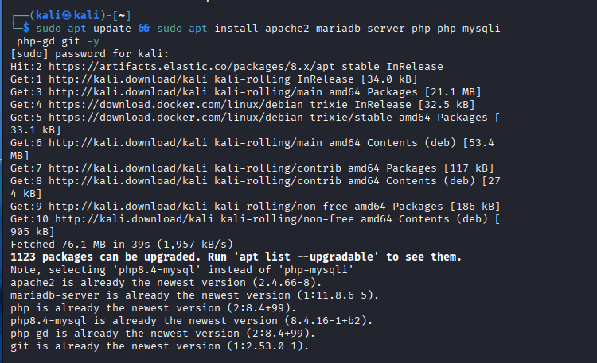

Start Apache and check that it is running by opening `http://127.0.0.1` in the browser:

```bash
sudo systemctl start apache2
```

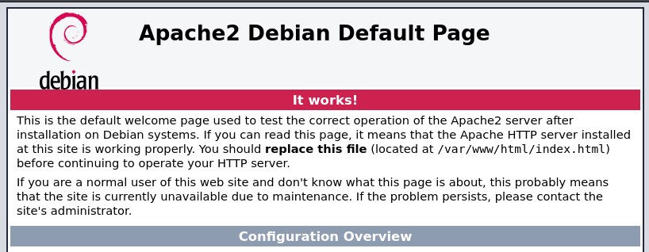

Clone DVWA into the web root:

```bash
cd /var/www/html
sudo git clone https://github.com/digininja/DVWA.git /var/www/html/dvwa
cd /var/www/html/dvwa
```

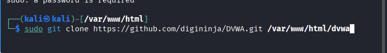
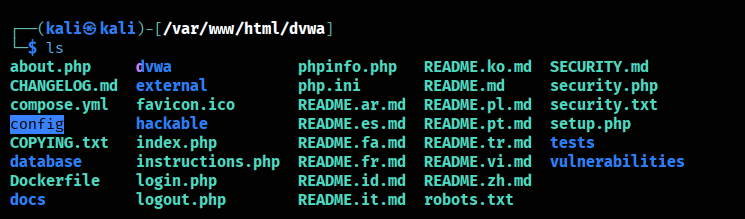

Set ownership and permissions. This gives the web server access to the files and limits write access to the owner, following the principle of least privilege:

```bash
sudo chown -R www-data:www-data /var/www/html/dvwa
sudo chmod -R 755 /var/www/html/dvwa
```

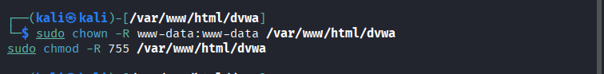

## Step 2: Configure the database

DVWA stores its users and vulnerability data in a database. Open the MariaDB prompt and create a dedicated user:

```bash
sudo mysql -u root
```

```sql
CREATE DATABASE dvwa;
CREATE USER 'dvwa_user'@'localhost' IDENTIFIED BY '<your-strong-password>';
GRANT ALL PRIVILEGES ON dvwa.* TO 'dvwa_user'@'localhost';
FLUSH PRIVILEGES;
EXIT;
```

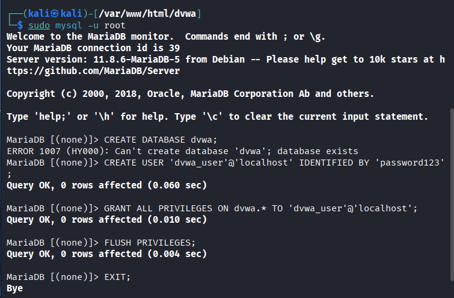

Use a strong password of your own. It only needs to be kept consistent with the next step.

## Step 3: Configure DVWA settings

DVWA ships with a distribution config file. Copy it and then edit the copy:

```bash
cd /var/www/html/dvwa/config
sudo cp config.inc.php.dist config.inc.php
sudo nano config.inc.php
```

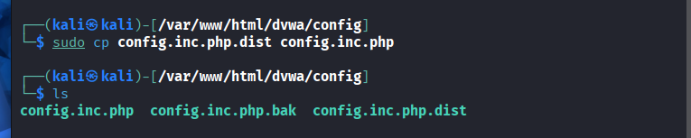

Set the database credentials to match Step 2:

```php
$_DVWA[ 'db_user' ]     = 'dvwa_user';
$_DVWA[ 'db_password' ] = '<your-strong-password>';
```

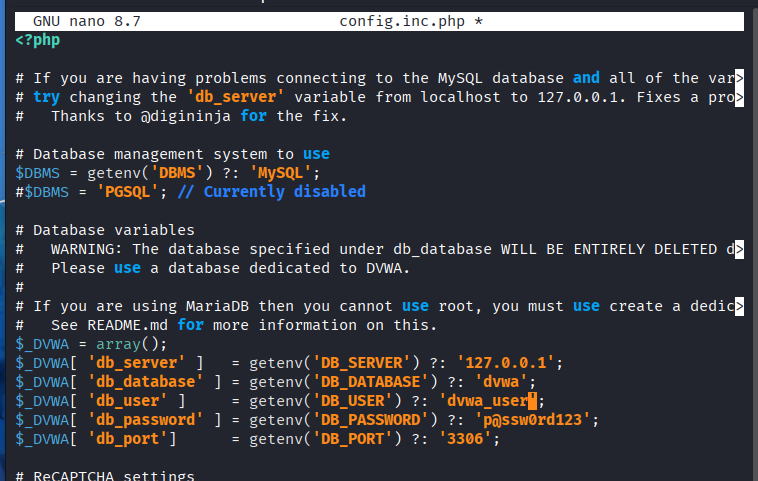

## Step 4: Configure PHP and Apache

Some vulnerabilities, such as File Inclusion, need specific PHP settings. Find the PHP configuration file that Apache uses:

```bash
php -i | grep "Loaded Configuration File"
```

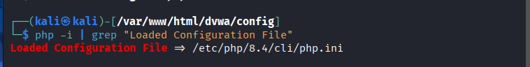

Open the Apache PHP configuration (for PHP 8.4 this is `/etc/php/8.4/apache2/php.ini`) and set:

```ini
allow_url_fopen = On
allow_url_include = On
max_execution_time = 30
memory_limit = 128M
```

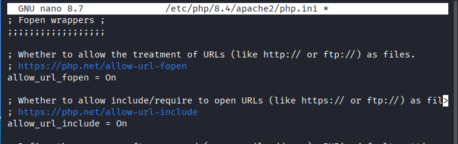
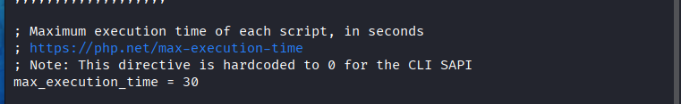
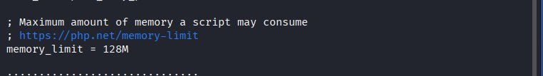

Restart Apache to apply the changes:

```bash
sudo systemctl restart apache2
```

To check that PHP is loaded correctly by Apache, create a test file containing `phpinfo()`:

```php
<?php
phpinfo();
?>
```

Open `http://127.0.0.1/info.php` in the browser. If PHP info is displayed, PHP and Apache are configured correctly.

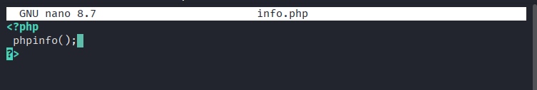
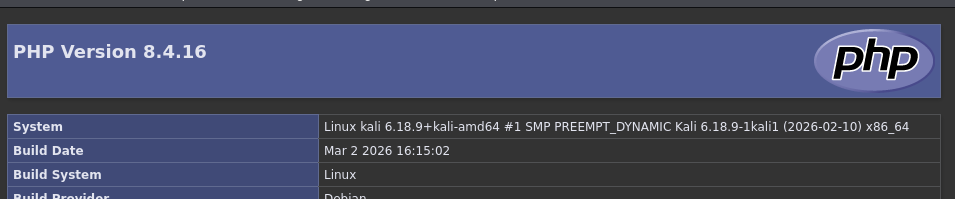

## Step 5: Final web setup and login

Open `http://localhost/dvwa/setup.php` and click **Create / Reset Database**.

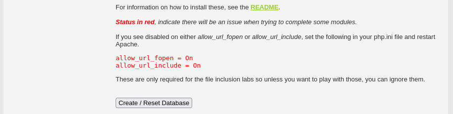

Log in with the default credentials:

- **Username:** `admin`
- **Password:** `password`

Change these defaults if the instance is reachable from anywhere other than your own VM.

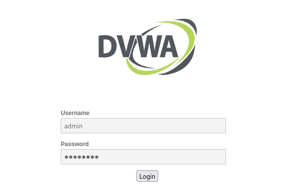
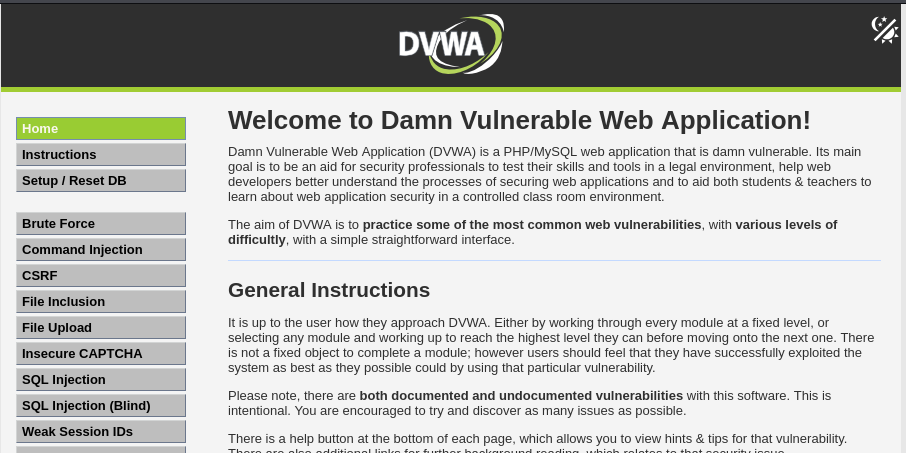

## Step 6: Security levels

DVWA has four security levels that control how severe the vulnerabilities are. Set the level from the **DVWA Security** page in the sidebar.

| Level | Description |
|---|---|
| **Low** | No security. Good for understanding the raw vulnerability. |
| **Medium** | Basic filters, for example blacklisting `<script>` tags. Good for learning bypasses. |
| **High** | Advanced filters and logic. |
| **Impossible** | Secure code. Shows how the code should be written to prevent attacks. |

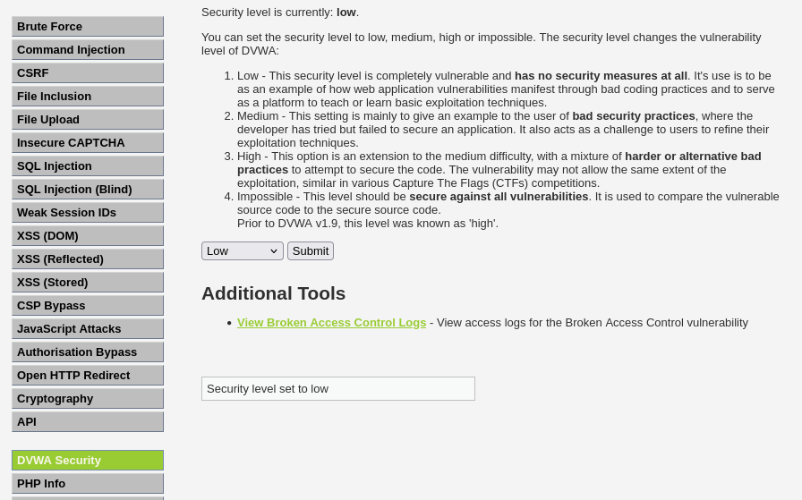

## Step 7: Testing scenarios

Set the security level to **Low** for these tests.

**SQL injection.** Go to **Vulnerabilities → SQL Injection** and enter `1' OR '1'='1` in the User ID field. The query runs because the input is not validated or sanitised.

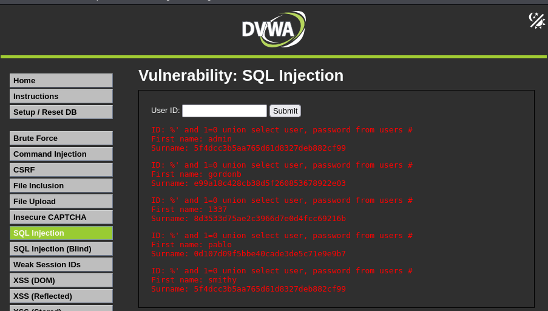

**Cross-site scripting (XSS).** Use a name or comment field that reflects user input, and enter:

```html
<script>alert('you have been hacked')</script>
```

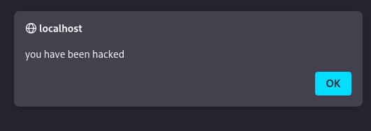

### How to prevent these issues

- Validate all input.
- Use prepared statements instead of building SQL strings from user input.
- HTML-encode output.
- Set a Content Security Policy (CSP).

## Files

- [`docs/DVWA-Installation-and-Configuration-Guide.pdf`](docs/DVWA-Installation-and-Configuration-Guide.pdf): the original guide
- [`images/`](images): screenshots for each step

## License

See [LICENSE](LICENSE).

## Author

Rahmatu Abdulkarim
